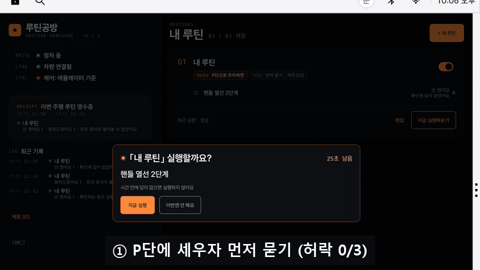
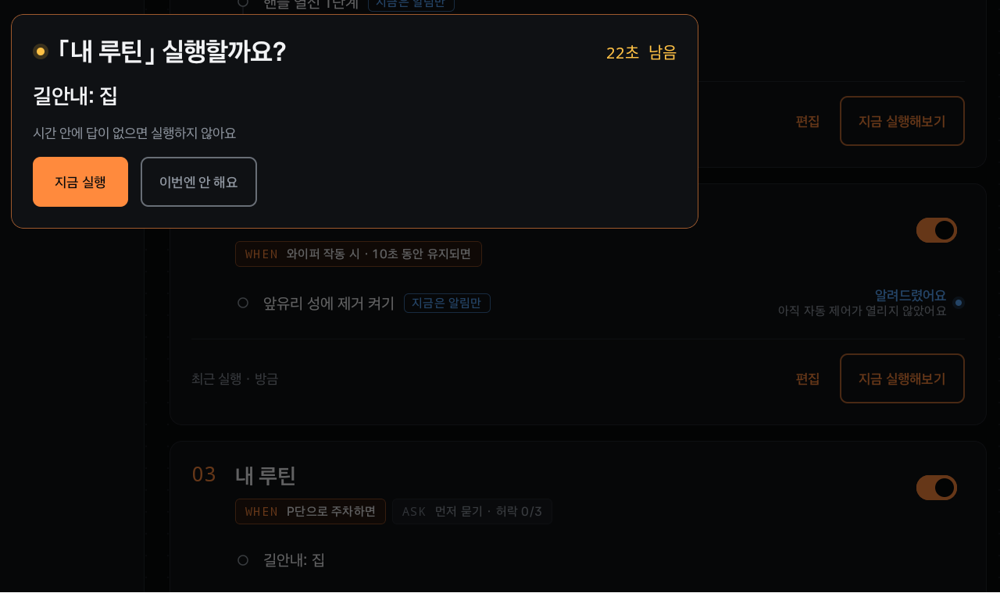
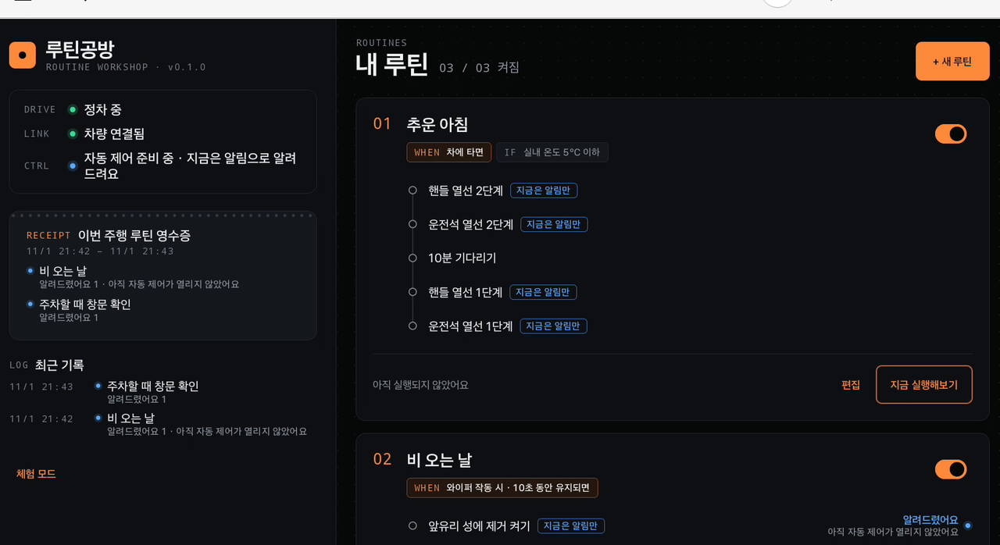
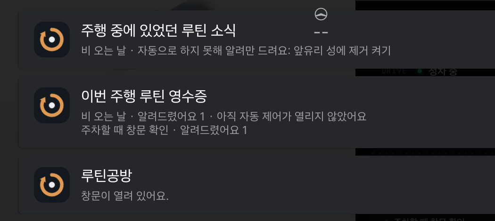
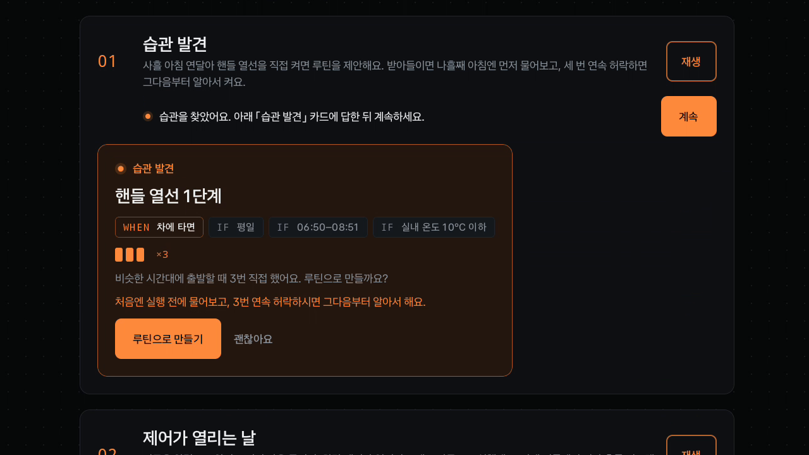
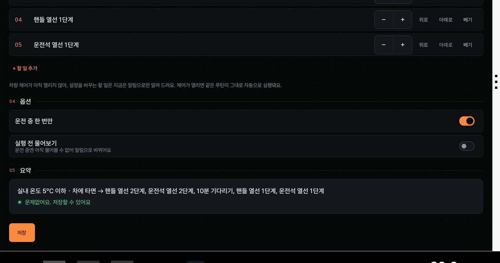
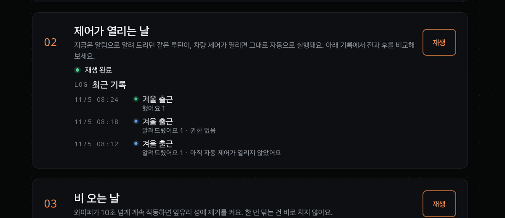

# 루틴공방

[](https://github.com/LcokHcak/routinegongbang/actions/workflows/ci.yml)

**운전자가 허락한 만큼만 자동으로 하고, 한 일과 못 한 일을 정직하게 알려 주는 차량 루틴의 '신뢰 레이어' (Pleos Connect 앱)**

차에서 늘 하던 조작(퇴근길 집으로 길안내, 비 오면 앞유리 성에 제거, 주차하면 창문 확인)을 "언제 · 어떤 조건에서 · 무엇을"로
묶어 두면, 차량 상태를 보고 그때가 오면 실행합니다. 루틴은 Pleos Connect에도, 다른 브랜드에도 이미 있습니다. 루틴공방이
더하는 것은 **믿고 맡길 수 있게 하는 장치**입니다.

- **먼저 묻기 → 알아서**: 새 루틴은 실행 전에 묻고, 운전자가 연속 3번 허락하면 그다음부터 묻지 않고 합니다.
- **주행 영수증**: P단에 세우고 20초 뒤, 이번 주행에서 루틴마다 무엇을 했는지와 못 한 이유를 한 장으로 알려 줍니다.
- **정직한 결과**: 했어요 / 알려드렸어요 / 안 했어요, 그리고 이유. 차가 확인하지 않은 요청은 "했어요"로 치지 않습니다.
- **운전자 우선**: 운전자가 직접 바꾼 설정은 그 주행 동안 다시 덮어쓰지 않습니다. 주행 중에는 아무것도 묻지 않습니다.

| | |
|---|---|
| 내려받기 | **[Release v0.1.0](https://github.com/LcokHcak/routinegongbang/releases/tag/v0.1.0)**: 서명된 APK와 시연 영상을 한 곳에서 (SHA-256 포함) |
| APK | [`apk/루틴공방_루틴공방_release.apk`](apk/루틴공방_루틴공방_release.apk) (서명된 release 빌드, 버전 0.1.0, 패키지 `kr.routinegongbang.app`) |
| 시연 영상 | [`video/루틴공방_데모.mp4`](video/루틴공방_데모.mp4) (2분 27초). Pleos Connect 에뮬레이터 화면 그대로입니다. 실제 신호 장면은 Virtual Console로 기어 · 와이퍼 · 창문을 바꿔 녹화했고, 단계적 신뢰 장면만 차량 제어가 열린 debug 빌드, 체험 모드 장면에는 「모의 차량」이라고 표시했습니다. |
| 테스트 | 단위 테스트 725개(core 488 · app 237), push마다 GitHub Actions에서 실행 |

---

## 화면

모두 Pleos Connect 에뮬레이터에서 실행한 실제 화면입니다(아래 GIF만 debug 빌드: 에뮬레이터에서 차량 제어가 열린 상태).

**먼저 묻기 → 연속 3번 허락 → 알아서** (Virtual Console로 D ↔ P를 바꾸며 녹화)



| 먼저 묻기 (P단에 세우자 30초 동안 묻고, 카드에는 '허락 0/3') | 주행 영수증과 최근 기록 (P단 20초 뒤) |
|---|---|
|  |  |
| **Pleos 알림 센터의 주행 영수증** (루틴마다 한 줄, 못 한 이유까지) | **습관 발견** (사흘 연속 직접 켠 핸들 열선을 조건과 함께 제안) |
|  |  |
| **저장 전 점검** (충돌 · 만들 수 없는 동작을 저장 전에) | **체험 모드 「제어가 열리는 날」** (같은 루틴이 알림 → 실행으로) |
|  |  |

## 3분 안에 보기

1. APK를 설치하고 실행합니다(아래 「실행 방법」). 권한은 모두 허용합니다.
2. 첫 화면의 **「바로 체험해 보기」** → **「습관 발견」 재생**: 모의 차량으로 사흘의 아침이 지나가고 습관 카드가 뜹니다. 받아들이면 나흘째 아침에 루틴이 먼저 묻고, 「지금 실행」을 누르면 실행합니다(단계적 신뢰 1/3).
3. **「제어가 열리는 날」 재생**: 같은 루틴이 제어 미개방(알림) → 권한 없음 → 제어 개방(실행)으로 바뀌는 과정을 기록으로 봅니다.
4. 실제 신호로 보려면 「체험 끝내기」 후 Virtual Console(아래 4번)에서 기어를 D → P로 바꿔 봅니다. 주행 중에는 편집이 잠기고, P단 20초 뒤 주행 영수증이 옵니다.

## 주요 기능

| 기능 | 설명 |
|---|---|
| 단계적 신뢰 | 습관 제안으로 만든 루틴과, 탑승 · P단 주차 순간에 동작하는 추천 루틴(더운 날, 퇴근길)은 '먼저 묻기'로 시작합니다. 「지금 실행」을 연속 3번 누르면 "3번 연속 허락하셔서, 다음부터는 묻지 않고 할게요" 알림과 함께 알아서 실행합니다. 거절 · 30초 무응답 · 루틴 수정 · 끄기 · 삭제가 있으면 처음부터 다시 셉니다. 기다리기가 있는 루틴은 계속 묻습니다. 묻는 것은 운전자가 앉아 있는 정차 순간뿐입니다. |
| 주행 영수증 | 주행 뒤 P단에 세우고 20초 뒤(주차 순간에 동작한 루틴까지 담기도록), 루틴마다 한 줄로 "했어요 / 알려드렸어요 / 안 했어요 · 이유", "건너뜀 n번 — 이유"를 알림 하나로 보냅니다. 주행 중 미뤄 둔 알림도 함께 붙고, 앱 화면에는 다음 주행까지 영수증 카드가 남습니다. |
| 정직한 실행 결과 | 결과를 **했어요 / 알려드렸어요 / 안 했어요**로 나누고, 차가 아직 확인하지 않은 요청은 "했어요"로 치지 않습니다. 실행하지 않은 경우에도 이유를 보여 줍니다(조건 불일치, 쉬는 중, 이번 주행에서 이미 함, 답이 없었음 등). |
| 루틴 편집기 | 템플릿 5종 또는 직접 만들기. 언제(차에 타면, P단 주차, 내려서 잠글 때, 비 올 때, 매일 정해진 시각, 운전 N분 후, 목적지 도착, 배터리 부족) · 조건(평일/주말, 시간대, 실내가 추울 때/더울 때, 동승자) · 동작(핸들 열선, 시트 열선/통풍, 에어컨, 풍량, 온도, 앞유리 성에 제거, 내기 순환, 집으로 길안내, 창문 열림 알림, 기다리기). 저장 전에 충돌과 위험을 한국어로 점검하고, 편집은 정차 중에만 됩니다. |
| 습관 발견 | 비슷한 상황(평일/주말, 시각, 탑승 시 실내 온도 구간)에서 같은 조작을 세 번 하면, 정차했을 때 루틴으로 만들자고 제안합니다. 추운 아침에 배운 습관에는 "실내 10°C 이하" 조건이 붙습니다. |
| 안전 규칙 | 주행 중 직접 바꾼 설정은 그 주행 동안 덮어쓰지 않습니다. 자동으로 바꿀 수 있는 범위를 넘으면 먼저 묻습니다. 문·창문은 움직이지 않고, 성에 제거는 끄지 않습니다. 주행 중에는 알림을 모아 두었다가 정차하면 한 번에 알려 줍니다. |
| 차량 제어가 열리기 전에도 동작 | Pleos Vehicle SDK의 차량 제어는 아직 일반 앱에 열려 있지 않습니다. 그래서 release 빌드는 설정을 바꾸는 대신 "자동으로 하지 못해 알려만 드려요" 알림을 보내고, 결과에도 그렇게 표시합니다(이 경우 묻지 않으므로, 지금 '먼저 묻기 → 알아서'가 실제로 일어나는 것은 길안내 루틴입니다). 제어 권한이 생기면 같은 루틴이 그대로 자동 실행 단계로 올라갑니다. |
| 체험 모드 | 첫 화면의 「바로 체험해 보기」로 모의 차량에서 네 가지 장면(습관 발견, 제어가 열리는 날, 비 오는 날, 퇴근길)을 재생합니다. 실제 차량 루틴은 그동안 멈춥니다. |
| Gleo 음성 연동 | Gleo Interface(`app/src/main/assets/schema.json`)로 "○○ 루틴 실행해 줘", "○○ 루틴 꺼 줘", "내 루틴 알려 줘"를 처리합니다. 실행은 정차 중에만, 켜기도 정차 중에만 됩니다. |

## 실행 방법

### 1. 에뮬레이터 준비

1. Android Studio → **SDK Manager → SDK Platforms**에서 Android 14 (API 34)의 **Pleos Connect v2.1.0 APIs** 시스템 이미지를 설치합니다(라이선스 동의 필요).
2. **Device Manager**에서 이 이미지로 Automotive 에뮬레이터(AVD)를 만들고 실행합니다.

### 2. APK 설치

```bash
adb install -r "apk/루틴공방_루틴공방_release.apk"
```

### 3. 앱 실행

1. 앱 목록에서 **루틴공방**을 실행합니다.
2. 처음 실행하면 권한을 묻습니다. 모두 허용해 주세요.
   - "위치 정보" 권한은 **차량 속도(`android.car.permission.CAR_SPEED`)** 를 읽기 위한 것입니다. Android Automotive가 이 권한을 위치 그룹으로 분류해서 그렇게 표시됩니다. 위치 좌표는 읽지 않습니다.
   - 권한을 거부해도 앱은 동작합니다. 화면 위 안내에서 「권한 다시 요청」을 누르면 다시 허용할 수 있습니다.
3. 처음 화면에서 **「바로 체험해 보기」** 를 누르면 체험 모드로 주요 장면을 바로 볼 수 있습니다.
4. 직접 루틴을 만들려면 정차 상태(P단)에서 **「+ 새 루틴」** 을 누르세요.

### 4. 실제 신호로 보기 (Virtual Console)

에뮬레이터에 들어 있는 Virtual Console로 기어, 좌석 착석, 와이퍼 등을 바꿔 가며 루틴이 언제 실행되는지 확인할 수 있습니다.

```bash
adb forward tcp:8088 tcp:8088
```

PC 브라우저에서 `http://localhost:8088`을 엽니다. 예를 들면:

- **주행 영수증**: 「비 오는 날」 루틴을 만들고 기어를 D로, 와이퍼를 10초 넘게 켠 뒤 P로 바꾸면, 20초 뒤 "이번 주행 루틴 영수증"이 옵니다.
- **먼저 묻기**: 「P단으로 주차하면 → 집으로 길안내」 루틴에서 '실행 전 물어보기'를 켜고 D → P로 바꾸면 30초 동안 묻습니다. 길안내가 되려면 에뮬레이터 내비게이션에 '집'이 등록돼 있어야 합니다.
- **차에 타면**: 운전석 착석을 바꾸면 "차에 타면" 루틴이 실행됩니다. (에뮬레이터의 좌석 착석 값은 반대로 들어오기 때문에 앱이 에뮬레이터에서만 뒤집어 읽습니다.)

### 5. Gleo 호출 재현 (adb)

Gleo가 보내는 것과 같은 방송을 adb로 보낼 수 있습니다. 함수 이름이 action이고, 인자는 JSON 문자열 하나(`ACTION_PARAM`)입니다. 응답은 `ai.pleos.playground.intent.action.APP_ACTION_RESPONSE` 방송으로 돌아옵니다.

```bash
adb shell am broadcast -n kr.routinegongbang.app/.gleo.GleoReceiver -a START_ROUTINE --es ACTION_PARAM '{"routineName":"추운 아침"}'
adb shell am broadcast -n kr.routinegongbang.app/.gleo.GleoReceiver -a SET_ROUTINE_ENABLED --es ACTION_PARAM '{"routineName":"추운 아침","enabled":false}'
adb shell am broadcast -n kr.routinegongbang.app/.gleo.GleoReceiver -a GET_ROUTINES
```

멀티 유저 에뮬레이터에서는 `--user <운전자 사용자 번호>`(예: `--user 10`)를 붙입니다. 실행은 정차 중에만, 켜기도 정차 중에만 됩니다.

## 테스트 환경 및 필요한 설정

| 항목 | 내용 |
|---|---|
| 에뮬레이터 | Pleos Connect v2.1.0 APIs, Android 14 (API 34), x86_64 |
| 최소 / 대상 SDK | minSdk 28 / targetSdk 35 |
| 필요한 권한 | 차량 속도·파워트레인·에너지(Android Automotive), Pleos 차량 정보(공조, 좌석, 창문, 문, 조명, 미러, 주행, 에너지, 안전), Pleos 길안내, 알림 |
| 네트워크 | 필요 없음 (모든 처리는 기기 안에서) |
| 실차 | 차량 제어 SDK가 열리기 전까지 동작은 알림으로 대신합니다. 체험 모드의 「제어가 열리는 날」에서 제어가 열린 뒤의 동작을 볼 수 있습니다. |

## 직접 빌드하기

JDK 17이 필요합니다. Pleos Connect SDK는 42dot이 공개한 Maven 저장소에서 자동으로 받습니다.

```bash
./gradlew :core:check :app:testDebugUnitTest   # 테스트
./gradlew :app:assembleDebug                    # 디버그 빌드 (에뮬레이터에서 차량 제어까지 시험)
./gradlew :app:assembleRelease                  # release 빌드
```

release 서명은 저장소 밖의 `keystore.properties`가 있을 때만 적용됩니다(`storeFile`, `storePassword`, `keyAlias`, `keyPassword`). 없으면 서명되지 않은 release APK가 만들어집니다.

## 사용한 SDK · API

| SDK · API | 버전 | 쓰는 곳 |
|---|---|---|
| Pleos Connect Vehicle SDK | 2.3.2 | 차량 신호 읽기와 구독(공조, 좌석, 와이퍼, 문, 창문, 충전 등), 디버그 빌드에서는 차량 제어 |
| Pleos Connect NaviHelper | 3.0.5 | 즐겨찾기(집·회사) 조회, 길안내 요청과 결과 확인, 길안내 상태·도착 이벤트 |
| Gleo Interface | — | 음성으로 루틴 실행 · 켜고 끄기 · 목록 조회 (`schema.json`, 방송 수신 · 응답) |
| Android Automotive Car API | API 34 | 기어 · 차량 속도 · 주행 제한 상태로 정차 여부 판단, 충전 상태 |

### 루틴 요소와 SDK 대응

| 루틴 요소 | SDK · API | 권한 | release 상태 |
|---|---|---|---|
| 언제: 차에 타면 · 내려서 잠글 때 | Vehicle SDK 좌석 착석 · 도어 잠금 리스너 | `CAR_SEATS` · `CAR_DOORS` | 동작(읽기) |
| 언제: P단으로 주차하면 · 정차 판단 | Car API `GEAR_SELECTION` · `PERF_VEHICLE_SPEED`, `CarUxRestrictionsManager` | `CAR_POWERTRAIN` · `CAR_SPEED` | 동작(읽기) |
| 언제: 비 올 때 · 배터리 부족 | Vehicle SDK 와이퍼 상태 · 충전량 리스너 | `CAR_WINDOWS` · `CAR_ENERGY` | 동작(읽기) |
| 언제: 목적지 도착 | NaviHelper `onDestinationArrived` | `NAVI_ROUTE` | 동작 |
| 조건: 실내 온도 · 동승자 · 창문 | Vehicle SDK 공조 온도 · 좌석 착석 · 창문 위치 | `CAR_CLIMATE` · `CAR_SEATS` · `CAR_WINDOWS` | 동작(읽기) |
| 할 일: 열선 · 통풍 · 공조 등 9종 | Vehicle SDK 설정 함수(`setHvac…` 등) | `CONTROL_CAR_CLIMATE` · `CONTROL_CAR_SEATS` | 알림으로 대체. debug 빌드에서 에뮬레이터 실제 쓰기 |
| 할 일: 집으로 길안내 | NaviHelper 즐겨찾기 조회 → `requestRoute`, `onRoutingCompleted` / `onError`로 결과 확인 | `NAVI_ROUTE` · `NAVI_ROUTE_SEARCH` | 동작(먼저 묻기 → 알아서) |
| 할 일: 알림 · 주행 영수증 | Android 알림(Pleos 알림 센터) | `POST_NOTIFICATIONS` | 동작 |
| 음성 | Gleo Interface `schema.json` 함수 3개 | — | 에뮬레이터 검증, Pleos 등록 전 |

읽는 차량 신호는 44종(Pleos Vehicle SDK 41 + Car API 3)입니다. 아직 열리지 않은 SDK(Vehicle Control, TTS, STT, 위치)는 쓰지 않고, 각각 알림 · 정차 후 묶음 알림 · 정차 중 화면 버튼 · 내비 즐겨찾기로 대신합니다.

## 구조

```
core/   순수 Kotlin (Android · Pleos 의존 없음)
  model/     루틴 데이터 모델과 검증, 신호 목록
  engine/    단일 스레드 이벤트 루프: 트리거(상태 변화 · 유지 시간), 조건, 쿨다운 · 횟수 제한,
             실행 등급(자동 / 먼저 묻기 / 알림), 결과 추적, 기다리기
  safety/    루틴 간 충돌 조정, 저장 전 점검
  habit/     습관 기록과 제안
  platform/  차량 능력 파악, 값 변환, 재시도
  fake/      모의 차량과 체험 시나리오 실행기
app/    Android
  pleos/     Vehicle SDK · NaviHelper 어댑터
  aaos/      Android Automotive 차량 속성
  service/   엔진을 돌리는 포그라운드 서비스, 단계적 신뢰 · 주행 영수증 판단
  gleo/      Gleo Interface 수신기
  platform/  알림, 권한, 주행 중 알림 보류
  ui/        Jetpack Compose 화면, 편집기, 체험 모드
```

엔진은 모든 차량 이벤트를 한 스레드에서 차례로 처리합니다. 그래서 같은 입력에는 항상 같은 결정이 나오고, 체험 시나리오와 테스트가 실제 앱과 같은 코드로 돌아갑니다.

## 테스트

- 단위 테스트 725개(core 488 · app 237): 엔진, 안전 규칙, 습관 발견, 단계적 신뢰, 주행 영수증, 편집기 점검, Gleo 응답, 체험 시나리오 6종을 모의 차량으로 끝까지 실행
- GitHub Actions에서 push마다 테스트와 디버그 빌드를 실행합니다.

## 알려진 한계

- 차량 제어 SDK가 일반 앱에 열리기 전까지 실차에서는 동작 대신 알림을 보냅니다. 이 경우 묻지 않으므로 단계적 신뢰는 지금 길안내 루틴에만 적용됩니다.
- 주행 영수증은 P단 20초 뒤에 나갑니다. 그보다 늦게 끝난 실행(예: 30초 가까이 답을 기다린 질문)은 다음 영수증에 들어갑니다.
- Gleo Interface의 `schema.json`은 아직 Pleos에 등록 · 심사를 받지 않았습니다. 에뮬레이터에서는 adb 방송으로 같은 호출을 시험했습니다.
- 실차에서 확인하지 못한 부분: 탑승 직후 실내 온도 값의 신선도, 일부 Pleos 권한의 표시 여부, 주행 제한(UX restriction) 상태를 읽는 권한.

## 라이선스

Copyright (c) 2026 루틴공방. All rights reserved. 심사와 열람을 위해 공개하며, 허락 없이 복제 · 수정 · 배포할 수 없습니다. 자세한 내용은 [LICENSE](LICENSE)를 보세요.

사용한 오픈소스와 참고한 설계는 [THIRD_PARTY_NOTICES.md](THIRD_PARTY_NOTICES.md)에 정리했습니다. Pleos Connect SDK는 42dot의
SDK 라이선스를 따르며 이 저장소에는 포함되어 있지 않습니다. "Pleos"와 "Gleo"는 해당 권리자의 상표입니다.
